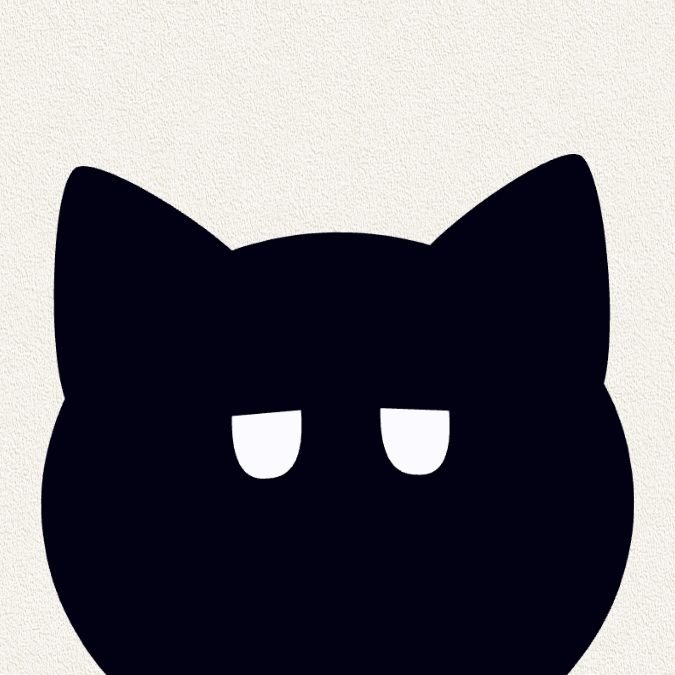
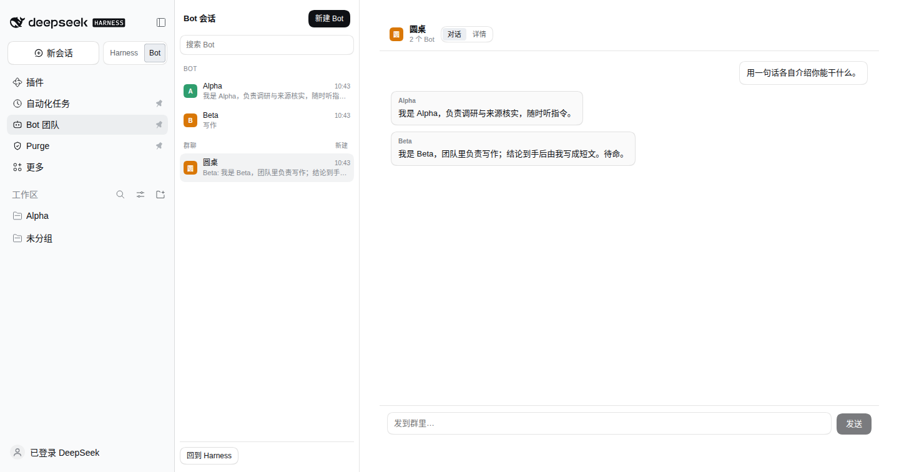
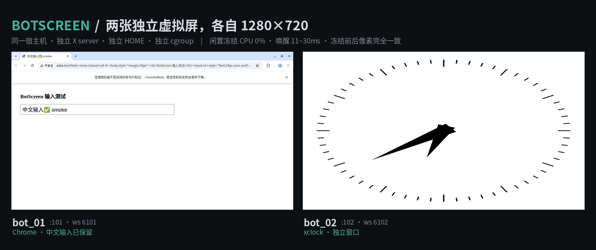
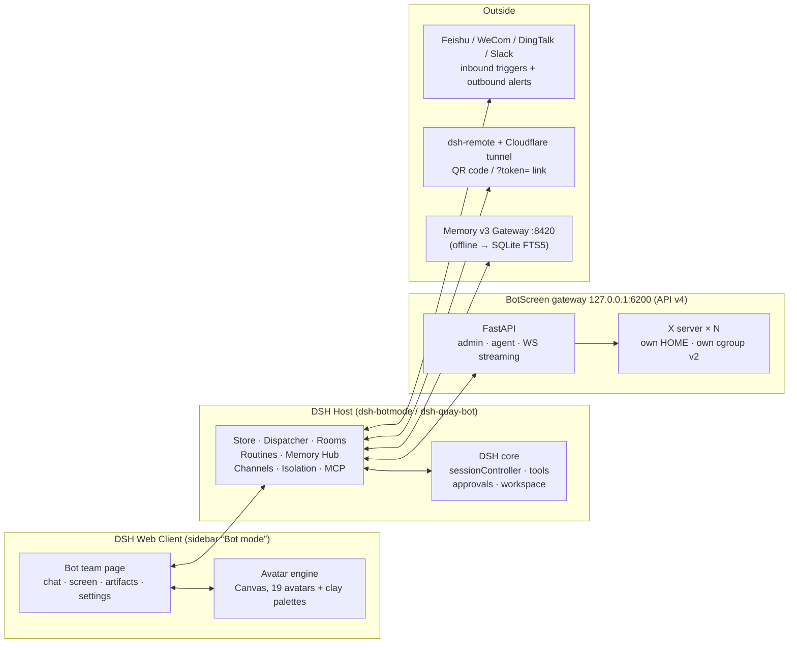

<div align="center">



<h1>Quay Bot</h1>

<p><strong>Give DeepSeek Harness a Bot team with names, desks and memory.</strong><br/>
Bot mode for DSH: isolated Bot identities, concurrent Group Rooms, a pluggable team memory hub, persistent routines and inbound triggers —
plus a bundled, screenshot-and-click capable BotScreen virtual desktop and a Remote entry point. Install the plugin and it runs; no separate <code>pip install</code> or itemized <code>apt install</code>.</p>

<p>
  <a href="./packages/dsh-quay-bot/package.json"></a>
  
  
  
  
  <a href="./packages/dsh-quay-bot/LICENSE"></a>
</p>

<p>
  <a href="./README.md">简体中文</a> ·
  <strong>English</strong>
</p>

<p>
  <a href="#why-quay-bot">Value</a> •
  <a href="#features">Features</a> •
  <a href="#two-distribution-packages">Packages</a> •
  <a href="#architecture">Architecture</a> •
  <a href="#quick-start">Quick start</a> •
  <a href="#tools-and-endpoints">Endpoints</a> •
  <a href="#security-and-isolation-model">Security</a> •
  <a href="#documentation">Docs</a>
</p>

</div>

---

> [!NOTE]
> BotScreen brings up a real virtual desktop per Bot (its own X server, its own HOME, its own cgroup). Only enable it on hosts you own or are explicitly authorized to use.

## Why Quay Bot

Wiring several agents into a team is not about "opening more chats". Four things decide whether it works: **how identities stay isolated, how a group conversation terminates, where memory lives, and who wakes the Bots when nobody is watching.** Hermes' Bot Mode reduces that to four pieces: a set of identified agents, a deterministic group-chat state machine, a pluggable memory store, and a resident scheduler.

Quay Bot maps each of those onto **real DeepSeek Harness primitives** instead of standing up another agent runtime:

- **A real team, not one giant session** — every Bot owns its directory (`bot.json` / `SOUL.md` / `MEMORY.md` / team skill), its own model and thinking level, its own tool allowlist and approval policy, and a permanent private chat. Bots hand work to each other with `message_agent`, guarded by a 4-hop cap and same-chain dedupe.
- **Rooms terminate on business state, not on a round counter** — a Group Room is an all-async `BotActor` bus: a slow Bot no longer blocks the table, and a snapshot watermark means concurrent replies and human interjections are never missed. Rooms end in exactly three states: `completed` (explicit acceptance), `settled` (everyone converged on `(pass)`), or `waiting_user` (waiting on you).
- **Bots can actually see a desktop** — each screen is an independent X server, a minimal WM, an isolated HOME and its own cgroup v2 subgroup. Idle screens are frozen in-kernel to **0% CPU**; a call from an agent or a human wakes them in **11–30 ms** with browser logins, forms and tabs intact.
- **Unattended operation** — persistent Routines wake cold sessions on cron; inbound webhooks let GitHub / Prometheus / CI / forms ping a specific Bot; outbound alerts push approvals, help requests and completions to Feishu / WeCom / DingTalk / Slack.

---

## Features

### Bot team and identity isolation

- **Three identity files**: `$DSH_HOME/botmode/bots/<slug>-<id>/` holds `bot.json`, `SOUL.md` (persona and standing instructions), `MEMORY.md` (long-term notes the Bot may edit itself), plus `.dsh/skills/team/SKILL.md` teaching it how to use teammate messaging and memory tools.
- **Permanent Bot chat**: `botId → canonicalSessionId`; `/new` and `/reset` take a memory checkpoint then compact **without switching session**. Sidebar sections, pinning and search all apply.
- **Per-Bot model binding**: follow the DSH default (empty binding, re-read every turn) or pin a provider/model plus thinking level. The live model catalog marks whether each model accepts image input; text-only models are rejected at enqueue time.
- **Image messages**: up to 6 PNG/JPEG/WebP/GIF files per message, ≤ 12 MB each, only when the Bot's current model declares `image` input.



### Group Room: 2–6 concurrent Bots

- **Three routing modes**: `auto` (parallel collaboration plus `@` hand-off), `everyone` (every member reviews in rotation), `lead` (a Lead dispatches and accepts; only the Lead may call `room_finish_task`).
- **All-async Actor bus**: each member runs inside its own hidden room session, so nobody blocks anybody. Before committing, a member pins the `snapshotSeq` watermark and records `selfSentSeqs`, so concurrent replies and human Soft Steer messages are never skipped; messages that only `@` a teammate advance the watermark at zero token cost.
- **Shared task board and file soft locks**: `claim_subtask({ taskId, paths })` claims a subtask and leases paths; DSH's `write` / `edit` / `apply_patch` / `str_replace_editor` are blocked at the tool guard when a teammate holds the path.
- **Three pathological probes**: 5 consecutive pure-text rounds with no tool calls soften the room (`idle_spin`); 3 identical error fingerprints pause only that Bot and broadcast a rescue alert (`paused_error`); a soft token checkpoint (`token_budget`, default 1M, `0` disables) preserves every session and watermark and resumes seamlessly.
- **Soft Steer vs hard stop**: an interjection bumps the epoch, wakes idle Bots and fences stale `@` mentions without killing in-flight scripts; **Stop** / `/stop` aborts the whole room.
- **Per-Bot streaming lanes**: reason, tool calls and streaming text render in separate lanes keyed by `botId`, then solidify into the main stream in `seq` arrival order.

### Team memory hub

- **One global provider, strict per-Bot isolation**: scoped by `(team_id, agent_id = bot.id, user_id, session_id)`.
- **Three built-in providers**: `memory_tencentdb` (TencentDB Agent Memory v3 Gateway at `127.0.0.1:8420`, parallel L0–L3 prefetch, async `syncTurn`, circuit breaker with automatic fallback), `local_sqlite` (zero-dependency SQLite FTS5 with a trigram tokenizer for Chinese and English), `builtin` (`MEMORY.md` only).
- **Install, swap, uninstall**: from catalog templates (Mem0 / Generic HTTP), `npm:` packages, Git repos, `.tgz` archives or local directories into `memory-plugins/<id>/`; switching is hot and applies to every subsequent turn.
- **Memory tools**: `memory_search` / `memory_conversation_search` / `memory_read_scene` / `memory_save` cover L1 atomic facts, L0 history, L2 scene blocks and explicit writes.

### Routines, inbound triggers and outbound alerts

- **Persistent Routines**: the Host parses five-field cron itself, wraps the timer in `ctx.effect()`, and supports cold-session wake, run-now, pause/resume, and run history.
- **Inbound webhooks**: `POST /botmode/api/webhook/<id>` with `Authorization: Bearer`, `X-Botmode-Secret`, or GitHub-style `X-Hub-Signature-256` HMAC (constant-time compare) wakes a single Bot or opens a Group Room.
- **Outbound alerts**: approvals, human-takeover requests (`screen_request_help`), room completion/escalation, token circuit breakers and routine failures are pushed asynchronously to generic webhooks, Feishu, WeCom, DingTalk or Slack, with a test button and the last 50 delivery logs.

### BotScreen virtual desktop

- **One screen, one world**: `bot_NN` maps to X `:10n`, the KasmVNC/x11vnc port and `/sys/fs/cgroup/botscreen/bot_NN`; each screen has its own HOME, so browser profiles and logins are naturally isolated.
- **Idle freeze**: when both the last agent call and the last human input are stale and nobody is watching, `cgroup.freeze=1` drives CPU to exactly 0; a following `memory.reclaim` pushes anonymous pages into zram/swap. Pixel diff before and after freeze is empty.
- **Agent tool surface**: `screen_screenshot` / `screen_click` / `screen_type` / `screen_key` / `screen_scroll` / `screen_drag` / `screen_open_app` / `screen_windows` / `screen_request_help`, all waking frozen screens and writing audit entries automatically.
- **Human takeover that behaves**: a console click or any key/pointer event switches to `HUMAN_TAKEOVER`, and agent input returns **423 Locked** (by default screenshots too). `screen_request_help` enters `NEED_HUMAN` and pushes an alert; `wait_human_release` blocks until release.
- **Self-laid desktop shell**: xfwm4 / openbox, picom compositing, pcmanfm wallpaper, dual tint2 (top bar + rounded translucent dock) and a custom icon layer (python-xlib + PIL single-window composition, double-click executes without the `.desktop` trust dance).



### Remote entry point

- The sidebar **Remote** button publishes the local DSH gateway through a Cloudflare tunnel using the bundled `dsh-remote`: it discovers the `dsh web` port and launch token, starts `cloudflared` and reports the public URL.
- The dialog is an app-connection page: a QR code from the zero-dependency encoder, the full `?token=` link, and copy / refresh / rotate app token / stop. Chips show liveness, tunnel mode, PSK kid and PID.
- Browser-side end-to-end links go through the CLI (`dsh-remote link`, key in the URL fragment, invisible to Cloudflare and CDN logs). The app link is a plaintext token, and the dialog says so explicitly.

### Avatars, artifacts and rich formatting

- **Native Bot avatars**: 19 bundled avatars, 12 clay palettes and custom JSON, with a 12-field preference set (`avatarId` / `customJson` / `color` / `eyeColor` / `material` / `clay` / `yaw` / `pitch` / `orbit` / `badge` / `depth` / `followPointer`). Drag to rotate in 3D, tap to poke; state follows agent signals across `idle / thinking / working / waiting / blocked / done`.
- **Artifact panel**: `<artifact>` outputs and delivered files are collected with inline preview for text / Markdown / code / images, single-file download and ZIP bundling (`manifest.json` included), SHA-256 digests, workspace path confinement and a 64 MB per-file cap.
- **Response format protocol**: optionally inject extended Markdown (GFM tables, callouts, diffs, collapsibles), Mermaid and LaTeX, structured `<artifact>` cards, metric/file cards and multimodal outputs, with a live format preview.

### Isolation and governance: Harness mode ↔ Bot mode

- **Five boundaries** (`host/isolation.js`, without touching DSH host files): prompt isolation (Harness-mode and third-party sections stripped, suppressed via `AsyncLocalStorage` during Bot steps), tool isolation (Bot-only tools registered strictly in each scoped `agent.ctx`), reversed Skills and MCP precedence per mode, and session/UI isolation (Bot sessions and directories never appear in the normal sidebar or search).
- **Bot-side MCP registry**: `$DSH_HOME/botmode/mcp.json`; Bot mode prefers Bot MCP, Harness mode prefers native MCP, and name collisions are flagged rather than silently overwritten.
- **Approvals and governance**: `approval/request` (once / session / always / deny) and `ask_user_question` are bridged by the Host. Rooms suspend locally without killing parallel members; unattended private chats **auto-deny after 2 minutes**. Bots can be Worker or Admin, with daily token budgets and a global default.

---

## Two distribution packages

Same source, two ways to install:

| Package | Role | Version | Install | Differences |
|---|---|---|---|---|
| **`dsh-quay-bot`** | Public release (npm / market index) | `1.0.1` | `dsh plugin install dsh-quay-bot` | Ships `vendor/wheels` (linux x86_64 + aarch64, CPython 3.12) and `vendor/pip`, offline-first bootstrap, bundled BotScreen, `builtin-skills/**`, `market/index.json`, `bin/doctor.mjs` |
| **`@local/dsh-botmode`** | Local dev package (raw sources) | `0.7.4` | `dsh plugin --profile desktop install ./packages/dsh-botmode` | Runs ESM sources directly; toggle `include:botmode` to reload. Uses the host Python environment |

State root, data formats and `teamId=dsh-botmode` are identical, so existing Bots, rooms and memory plugins carry over. **Do not enable both in one profile** — both patch `include:botmode`.

---

## Architecture



<details>
<summary><strong>Repository layout</strong></summary>

```text
.
├── packages/
│   ├── dsh-botmode/                 # local dev package @local/dsh-botmode
│   │   ├── index.js                 # Host entry: services, tools, commands, HTTP, approval bridge
│   │   ├── client.js                # Client module: Bot page, rooms, screen, artifacts, settings, i18n
│   │   ├── host/                    # store / dispatch / rooms / routines / memory / channels …
│   │   ├── avatar/                  # avatar engine (TS sources + dist bundle + 19-entry catalog)
│   │   ├── builtin-skills/          # 7 built-in team skills
│   │   ├── remote/                  # embedded dsh-remote (Cloudflare tunnel + E2E proxy)
│   │   ├── botscreen/               # bundled Python gateway (same source as repo root)
│   │   └── test/                    # 9 headless suites + remote/test
│   └── dsh-quay-bot/                # public package dsh-quay-bot
│       ├── vendor/{pip,wheels}      # offline pip + dual-arch wheels
│       ├── market/index.json        # plugin market index (format 1)
│       ├── bin/doctor.mjs           # npx dsh-quay-bot self-check
│       └── docs/DETAIL.md           # rooms / memory / Remote design notes
├── botscreen/                       # BotScreen Python package (gateway, driver, state machine, audit)
├── web/index.html                   # BotScreen console (static, build-free)
├── deploy/                          # systemd units, cgroup setup, sample MCP config
├── tools/                           # desktop asset generation, CDP checks, smoke tests
├── install.sh                       # BotScreen one-shot installer (deps + KasmVNC + cgroup + zram)
├── BOTSCREEN.md                     # virtual-screen design doc (state machine / API / measurements)
├── README.md / README.en.md         # project introduction (Chinese / English)
└── docs/
    ├── BOTMODE.md                  # Bot mode implementation details (Host API / commands / layout)
    └── images/quay-bot-logo.jpg    # project logo
```

**Key mapping**: `bot_NN` → X `:(100+n)`, WS `(6100+n)`, RFB `(5950+n)` (loopback only), cgroup `/sys/fs/cgroup/botscreen/bot_NN`, data `/data/botscreen/bot_NN/{home,downloads,audit,runtime}`.

</details>

---

## Quick start

### Requirements

- **Linux** for BotScreen (verified on Ubuntu 24.04 aarch64/x86_64, Debian 13, and inside containers with cgroup v2)
- **Node ≥ 22.13** (`node:sqlite` without flags) and **DSH ≥ 0.2.2-rc.3**
- **Python 3.12** (the public package ships wheels, so no manual `pip install`)
- **root or passwordless sudo** for the first screen-dependency install (`sudo` missing prints a copy-paste command and never blocks other features)
- **cgroup v2 unified** for freeze (`install.sh` checks it and points at `systemd.unified_cgroup_hierarchy=1`)

### Install the plugin (recommended: public package)

```bash
dsh plugin install dsh-quay-bot
# Desktop: Plugin Manager → Install → dsh-quay-bot
# Or add packages/dsh-quay-bot/market/index.json as an index source in Discover
```

Then open **Bot mode** from the sidebar robot icon or the bottom button.

### Or install the local dev package from source

```bash
dsh plugin --profile desktop install ./packages/dsh-botmode
# After edits: toggle include:botmode off/on in Plugin Manager; client-only changes need a refresh
```

### What happens on first boot

`host/screen.js` prepares the screen stack itself, in a fixed, skippable order:

1. Probe `127.0.0.1:6200/healthz` and reuse a healthy gateway;
2. Find Python: `BOTSCREEN_PYTHON` → `$DSH_HOME/botmode/screen-venv` → bundled `.venv` → repo `.venv` → `python3` (used in place if its import probe passes);
3. Otherwise create a venv, seed pip from the bundled wheel, and `pip install --no-index --find-links vendor/wheels/{any,linux-<arch>}` (falls back to PyPI only if the interpreter does not match);
4. Probe 14 system binaries and run one `apt-get install` for whatever is missing;
5. Launch `python -m botscreen`, logging to `$DSH_HOME/botmode/botscreen-gateway.log`.

Disable auto-install with `BOTSCREEN_AUTO_INSTALL_DEPS=0`.

### Build the team

1. **Create a Bot**: name, role, standing instructions, section, model, thinking level, vision, toolset, approval and governance policy.
2. **Chat with it**: replies use official trace styling (collapsible reasoning, expandable tool calls, streaming shimmer), support images and `/` commands.
3. **Create a Group Room**: pick 2–6 Bots, choose a routing mode, set the goal and shared notes, then send a message. `@Bot` picks the first speaker; `@teammate` hands off; `@user` parks the room in `waiting_user`.
4. **Watch the table move**: per-Bot streaming lanes, activity chips and the shared task board at the bottom; approvals appear as a top bar (once / session / always / deny).
5. **Put a Bot on a desktop**: use the Bot's **screen** panel to screenshot, click, type or launch apps, or let it call `screen_*`; press **Take over** to hand control to a human.

### Self-check

```bash
npx dsh-quay-bot            # human-readable: node / python / system bins / wheels / gateway
npx dsh-quay-bot --json     # machine-readable
npx dsh-quay-bot --fix-hint # only the commands you need to run
```

### Standalone BotScreen (works without the plugin)

```bash
./install.sh                       # deps + KasmVNC/Xvfb + venv + cgroup v2 + zram + dirs + self-check
.venv/bin/python -m botscreen      # start the gateway
open http://127.0.0.1:6200/        # console: takeover, files, audit, host metrics

sudo ./deploy/install-systemd.sh   # install as a system service (/opt/botscreen, boot-enabled)
```

Paste [`deploy/mcp.json`](./deploy/mcp.json) into any MCP client; `python -m botscreen.mcp_server` also runs the gateway surface as a standalone MCP server.

### Tests

```bash
cd packages/dsh-quay-bot  && npm test     # 9 headless suites
cd packages/dsh-botmode   && npm test     # 9 headless suites + remote/test
```

Coverage: cron parsing, store and identity files, session isolation and FIFO, models and image capability, room-protocol pure functions and the multi-round state machine, `message_agent` guards, Memory Hub (including fallback paths), approval policies, isolation and dual-mode precedence, inbound/outbound channels, artifacts, avatars, QR, Remote proxy, venv bootstrap and system dependency detection.

---

## Tools and endpoints

### Agent tools (Bot primary session or hidden room session)

| Tool | Purpose |
|---|---|
| `message_agent({ target, message, expectReply? })` | Async teammate message: session-level FIFO, 4-hop guard, same-chain dedupe, ambiguity rejection, >16k spill to disk |
| `bot_team({ action })` | Roster, own identity (with `inRoom` / `running` / `queued`), joined rooms |
| `bot_manage` / `room_manage` | Create, edit or delete Bots and rooms (behind the approval gate) |
| `claim_subtask({ taskId, paths })` / `room_task_progress` / `room_finish_task` | Task board claim, progress reports, explicit acceptance into `completed` |
| `scheduled_tasks` | Create / edit / run / pause own cron routines |
| `memory_save` + `memory_*_search` / `memory_read_scene` | Explicit writes and layered recall |
| `screen_screenshot` / `screen_click` / `screen_type` / `screen_key` / `screen_scroll` / `screen_drag` / `screen_open_app` / `screen_windows` / `screen_request_help` | Virtual-desktop control and human escalation |
| `system_info` / `publish_artifact` | Host metrics and artifact publication |

### HTTP

All requests pass the DSH same-origin/login fence first (401 when unauthenticated).

| Method and path | Purpose |
|---|---|
| `GET /botmode/api/state` | Roster, sections, rooms (transcript / activity / watermarks / budget / runtime), routines, approvals, memory summary |
| `GET /botmode/api/models[?force=1]` | Live model catalog, thinking levels, `vision` capability, current default |
| `GET /botmode/api/memory` | Memory Hub state, installed providers, installable catalog, health probe |
| `POST /botmode/api/image` | Image bytes → `{ ok, attachment }` (PNG/JPEG/WebP/GIF) |
| `POST /botmode/api/command` | `{ type, ... }`: `bot.*` / `room.*` / `routine.*` / `approval.decide` / `question.decide` / `memory.*` / `remote.*` |
| `GET /botmode/api/remote[?qr=0]` | Remote runtime, links and QR code |
| `GET /botmode/api/screen/{status,preview,stream,audit}`, `POST /botmode/api/screen/{input,files}` | Screen management proxy |
| `GET / PUT /botmode/api/avatar`, `GET /botmode/api/avatar/catalog` | Avatar preferences and catalog |
| `GET / POST / DELETE /botmode/api/artifacts`, `POST /botmode/api/artifacts/bundle` | Artifact list, download, ZIP bundling |
| `POST /botmode/api/webhook/<id>` | Inbound trigger (Bearer / `X-Botmode-Secret` / HMAC-SHA256) |

The BotScreen gateway (`127.0.0.1:6200`) exposes its own surface: admin `/api/screens/*` (start / stop / freeze / thaw / takeover / release / brake / preview / audit / files / avatar), agent `/api/agent/{bot}/*` (screenshot / click / type / key / scroll / drag / open_app / windows / request_help / wait_release), host metrics under `/api/system/*`, and `/api/artifacts/*`.

### Human commands

```text
/botmode status
/botmode roster
/botmode dispatch <bot> <text>
/botmode room <roomId> <text>
/botmode routine <routineId>
/botmode memory status|list|use <id>|test|install <source>|uninstall <id>
/botmode scaffold
```

### BotScreen MCP (`deploy/mcp.json`)

`screen_screenshot` · `screen_click` · `screen_type_text` · `screen_key` · `screen_scroll` · `screen_drag` · `screen_open_app` · `screen_windows` · `request_human_help` · `wait_human_release` · `screen_status` · `screen_list`

---

## Security and isolation model

| Surface | Mechanism |
|---|---|
| **Harness ↔ Bot mode** | Five boundaries: prompt stripping, tool scoping, reversed Skills/MCP precedence per mode, filtered session and workspace lists; DSH host files untouched |
| **Between Bots** | Separate directories, private sessions and per-room hidden sessions; memory scoped by `(team, agent, user, session)` |
| **Screen control** | `runtime/lease.json` (`flock` + atomic `os.replace`) with a monotonic `epoch`; requests may send `X-Expected-Epoch` and get **409** if control moved |
| **Fail-closed** | An unreadable or malformed lease is treated as `human`, so every agent operation — screenshots included — returns **423** |
| **Human takeover** | Agent input gets 423 during `HUMAN_TAKEOVER`; with `BOTSCREEN_SCREENSHOT_FAIL_CLOSED=1` (default) agent screenshots are refused too. The console's read-only preview is not an agent identity and stays available |
| **Agent identity** | Per-screen `runtime/token.json` (mode 600) plus an `X-Agent-Token` header; admin endpoints require admin |
| **Exposure** | The gateway binds `127.0.0.1` only; DSH-side `/botmode/api/*` sits behind the same-origin/login fence; cross-host takeover requires an explicit tunnel |
| **Emergency brake** | `POST /api/brake` freezes every screen and rotates every agent token (7–22 ms measured) |
| **Resource gate** | Starting a screen compares cgroup headroom with `MemAvailable` and returns **409** below `BOTSCREEN_MIN_FREE_MB` (default 1024) instead of over-committing |
| **Inbound webhooks** | Bearer / custom header / HMAC-SHA256, compared with `timingSafeEqual` |
| **Approvals** | once / session / always / deny; rooms suspend locally without killing peers; unattended private chats auto-deny after 2 minutes |
| **Remote** | The browser-side PSK lives only in the URL fragment (never in CDN logs) and can be rotated; the app link is a plaintext `?token=`, labelled as not end-to-end encrypted |
| **Artifacts and files** | Confined to the workspace, ≤ 64 MB per file, SHA-256 digests, and write tools respect room path soft locks |

---

## Measured resources and performance

On a single 4 vCPU host (numbers recorded in [BOTSCREEN.md](./BOTSCREEN.md)):

| Metric | Value |
|---|---|
| Cold start of one screen (X server + WM ready) | 0.6 s |
| Frame capture + JPEG encode | 10–20 ms |
| Screenshot API end to end (including audit write) | 42 ms / ~50 KB |
| Click API end to end (including audit thumbnail) | 158 ms |
| Freeze → wake | 11–30 ms |
| CPU while frozen | 0 µs / 10 s (strictly zero) |
| Global brake (4 screens) | 7–22 ms (reclaim runs in the background) |
| Pixel diff across a 2 s freeze | identical (bbox = None) |
| Empty screen (frozen + reclaimed) | 9.6 MB / 2 processes |
| Chrome screen (frozen + reclaimed) | 82.6 MB / 13 processes |
| Gateway itself | RSS 60 MB / CPU 0.1% |

Capacity rule of thumb: the binding constraints are PIDs, the WS port range and kernel slab, not the memory figure. **20–30 screens on 16 GB** is the practical range, provided most screens stay frozen (5 active + 25 frozen ≈ 1.1 GB).

---

## Tech stack

- **Plugin**: Node ≥ 22.13, pure ESM, **zero third-party JS dependencies** (only an optional dynamic `import` of `@deepseek-ai/dsh-mcp-client`, with graceful fallback); the client module injects `dsh-client-locale` / `ui-layout` / `ui-sidebar` / `ui-workspace` / `dsh-api-session-controller`
- **Frontend**: plain DOM rendering, a Canvas avatar engine (TypeScript built into a single `avatar-engine.js`), built-in `en` / `zh` strings
- **Virtual screens**: Python 3.12 with FastAPI / uvicorn / Pillow / python-xlib / websockets / httpx / mss; X backend is either KasmVNC `Xvnc` (32-bit with ARGB visuals) or upstream X.Org `Xvfb` plus `x11vnc` + `websockify` + `noVNC`
- **Desktop shell**: `xfwm4` / `openbox`, `picom`, `pcmanfm`, `tint2`, and a custom python-xlib icon layer
- **Foundation**: cgroup v2 `freeze` + `memory.reclaim`, zram (zstd), a shared `Xauthority`, and `flock`-guarded atomic writes

---

## Documentation

- [Bot mode implementation details](./docs/BOTMODE.md) — Host API, command table, persisted state, directory rules, test coverage
- [BotScreen design doc](./BOTSCREEN.md) — state machine and leases, REST/MCP surface, pitfalls, capacity measurements, Hermes comparison
- [Rooms / memory / Remote design notes](./packages/dsh-botmode/docs/DETAIL.md)
- [Public package notes](./packages/dsh-quay-bot/README.md) — dependency bootstrap, doctor, market index, relationship to the dev package
- [Market index](./packages/dsh-quay-bot/market/index.json) · [systemd unit](./deploy/botscreen.service) · [MCP config](./deploy/mcp.json) · [console source](./web/index.html)

---

## Known limitations

- **BotScreen is single-host**: lifecycle is already funneled through `ScreenWorker`, but cross-host scheduling needs the worker abstracted into a remote executor.
- **No screenshots while frozen**: the X server is paused in-kernel; the console keeps showing the last frame for `FROZEN` screens.
- **`screen_type` relies on the clipboard**: target apps must support `ctrl+v` (browsers, GTK and Qt all do); terminals need `paste_key="shift+Insert"`.
- **Embedded live control is limited**: KasmVNC's VDI detection interferes; real takeover uses the console's top-level window while embedding stays read-only.
- **The Xvfb backend is 24-bit**: translucent rounded docks need 32-bit depth, i.e. the KasmVNC backend.
- **Protocol alignment**: currently aligned with DSH `0.2.2-rc.3` Typert / projection schemas; there is no runtime negotiation, so server upgrades may need adapter work.
- **Image input** requires the model to declare `image` in `inputModalities`; otherwise the message is refused before enqueue.
- **The two packages cannot coexist** in one profile: enable either `dsh-quay-bot` or `@local/dsh-botmode`.
- **Approvals default to deny**: unattended private chats auto-deny after 2 minutes by design; pair long unattended runs with outbound alerts.
- **Localization**: the Web client ships `en` / `zh`; the BotScreen console is currently Chinese-first.

---

## Contributing

1. Fork the repo and create a feature branch;
2. Run the package tests before pushing: `cd packages/<pkg> && npm test`;
3. Screen-related changes should include before/after freeze screenshots and the `cgroup.freeze` state; protocol changes should state the DSH version they target;
4. Open a PR describing motivation, blast radius and verification.

When filing an issue, include the DSH version, the plugin package and version, the BotScreen backend (`kasmvnc` / `xvfb`), the output of `npx dsh-quay-bot --json`, and the tail of the gateway log.

---

## License

Released under the **MIT License**; see [LICENSE](./packages/dsh-quay-bot/LICENSE) for the full text.