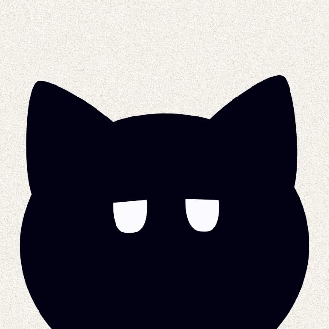
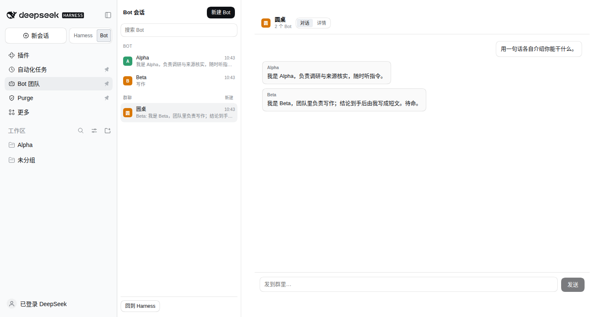
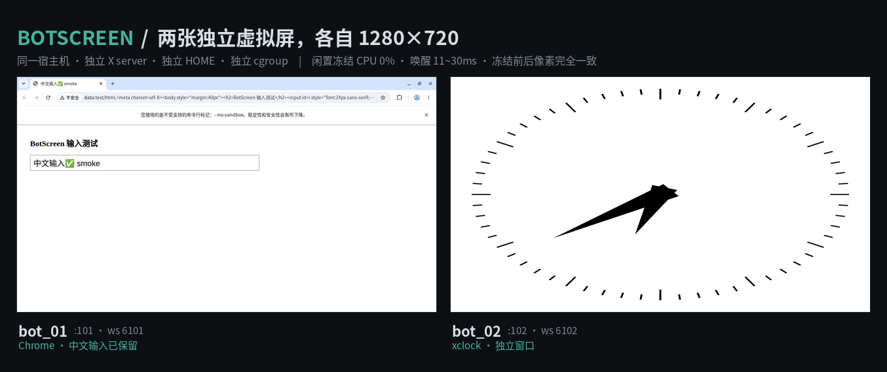
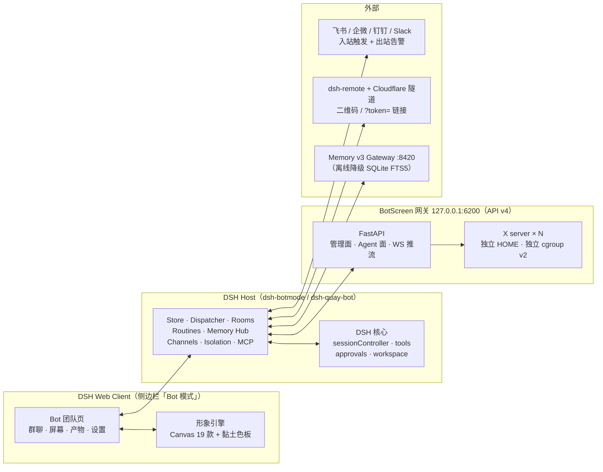

<div align="center">



<h1>Quay Bot</h1>

<p><strong>给 DeepSeek Harness 装上一支有名字、有工位、有记忆的 Bot 团队。</strong><br/>
DSH 的 Bot 团队模式：独立 Bot 身份、Group Room 并发群聊、可插拔团队记忆库、定时例程与外部触发，
外加一套随包自带、可截图可点击的 BotScreen 虚拟桌面和 Remote 远程入口——装上就能用，不必另装 Python 依赖或逐个 <code>apt install</code>。</p>

<p>
  <a href="./packages/dsh-quay-bot/package.json"></a>
  
  
  
  
  <a href="./packages/dsh-quay-bot/LICENSE"></a>
</p>

<p>
  <strong>简体中文</strong> ·
  <a href="./README.en.md">English</a>
</p>

<p>
  <a href="#为什么是-quay-bot">核心价值</a> •
  <a href="#核心特性">核心特性</a> •
  <a href="#两种发行包">发行包</a> •
  <a href="#系统架构">架构</a> •
  <a href="#快速开始">快速开始</a> •
  <a href="#工具与接口">接口</a> •
  <a href="#安全与隔离模型">安全模型</a> •
  <a href="#相关文档">相关文档</a>
</p>

</div>

---

> [!NOTE]
> BotScreen 会为每个 Bot 拉起一张真实的虚拟桌面（独立 X server + 独立 HOME + 独立 cgroup）。请只在你自有或已获明确授权的主机上启用这项能力。

## 为什么是 Quay Bot

把多个 Agent 拼成一支团队，难的从来不是「多开几个会话」，而是四件事：**身份怎么隔离、群聊怎么收敛、记忆落在哪里、没人看着的时候谁来叫醒它们**。Hermes 的 Bot Mode 把这四件事归结为「一组有身份的 agent + 一个群聊确定性状态机 + 一个可插拔记忆库 + 一个常驻调度器」。

Quay Bot 就是把这四件事**逐项落到 DeepSeek Harness 的真能力上**，而不是另起一个 Agent runtime：

- **一支真团队，而不是一个超长会话** —— 每个 Bot 有自己的目录（`bot.json` / `SOUL.md` / `MEMORY.md` / 团队 Skill）、独立模型与思考档位、独立工具白名单与审批策略，以及一条永久私聊会话；Bot 之间用 `message_agent` 互相派活，带 4 跳护栏与同链去重。
- **群聊有终态，不靠轮数硬切** —— Group Room 是全异步 `BotActor` 并发总线：慢 Bot 不再拖死整桌，快照水位线保证并发回复与人类插话一个都不漏；结束只有 `completed`（显式验收）/ `settled`（全员 `(pass)`）/ `waiting_user`（等你拍板）三种真实业务终态。
- **Bot 真的能「看见桌面」** —— 每张虚拟屏是独立 X server + 极简窗口管理器 + 独立 HOME + 独立 cgroup v2 子组。闲置时内核级冻结到 **CPU 0%**，Agent 或人类一叫就在 **11–30 ms** 唤醒，浏览器登录态、表单、标签页原样保留。
- **没人看着也能跑** —— Host 侧持久 Routines 按 cron 冷会话唤醒；入站 Webhook 让 GitHub / Prometheus / CI / 表单直接点名叫醒某个 Bot；出站通知把审批、求助、任务完成推到飞书 / 企微 / 钉钉 / Slack。

---

## 核心特性

### Bot 团队与身份隔离

- **独立身份三件套**：`$DSH_HOME/botmode/bots/<slug>-<id>/` 下的 `bot.json`、`SOUL.md`（人格与常驻指令）、`MEMORY.md`（Bot 可自己改的长期记忆），外加 `.dsh/skills/team/SKILL.md` 教它怎么用队友消息与记忆工具。
- **永久 Bot Chat**：`botId → canonicalSessionId`，`/new`、`/reset` 触发记忆检查点后做 compaction，**不换会话**；侧边栏按 Section 分组、置顶与搜索。
- **模型与能力可单独绑定**：默认跟随 DSH 默认模型（空绑定，每轮重读），也可指定 provider/model、思考档位；模型目录会标出每个模型是否支持图片输入，纯文本模型在 Host 入队前就被拒。
- **图片对话**：每条消息最多 6 张 PNG/JPEG/WebP/GIF、每张 ≤ 12 MB，需该 Bot 当前模型声明 `image` 输入能力。



### Group Room：2–6 人并发群聊

- **三种路由**：`auto`（并发协作 + `@` 接力）、`everyone`（全员顺位轮转审阅）、`lead`（Lead 派工与验收，仅 Lead 可 `room_finish_task`）。
- **全异步 Actor 总线**：每个成员跑在自己的隐藏群聊会话里，互不阻塞；提交前锁定 `snapshotSeq` 水位线并记录 `selfSentSeqs`，并发回复、人类 Soft Steer 插话都不会漏看；只 `@` 他人的消息零 Token 推进水位线。
- **共享任务板与文件软锁**：`claim_subtask({ taskId, paths })` 认领子任务并声明路径租约，DSH 的 `write` / `edit` / `apply_patch` / `str_replace_editor` 在工具拦截层直接挡掉队友已锁的路径。
- **三个病态探针**：连续 5 轮纯文本零工具空转（`idle_spin`）软暂停整桌、单个 Bot 连续 3 次相同错误指纹（`paused_error`）局部暂停并广播求助、软 Token 预算检查点（`token_budget`，点继续无缝续跑，默认 1M，`0` 关闭）。
- **Soft Steer 与硬停**：中途发言只抬 epoch、唤醒空闲 Bot、隔离 steer 之前的过期 `@`，在途脚本不被强杀；`/stop` 或点**停止**才整体中止。
- **分轨流式渲染**：底部按 `botId` 分轨显示思考、工具调用与流式正文，完成后按 `seq` 到达顺序固化进主聊天流。

### 团队记忆库（Memory Hub）

- **一套全局记忆库，严格按 Bot 隔离**：`(team_id, agent_id = bot.id, user_id, session_id)` 四维切分，Bot 之间互不串味。
- **内置三种 Provider**：`memory_tencentdb`（对接 TencentDB Agent Memory v3 Gateway `127.0.0.1:8420`，L0–L3 并行预取、异步 `syncTurn`、熔断后自动降级）、`local_sqlite`（纯本地零依赖 SQLite FTS5，中英混合 trigram）、`builtin`（只用 `MEMORY.md`）。
- **可装、可换、可卸**：从目录模板（Mem0 / Generic HTTP）、`npm:` 包、Git 仓库、`.tgz` 归档或本地目录一键安装到 `memory-plugins/<id>/`，页面里热切换即对所有后续 turn 生效。
- **记忆工具**：`memory_search` / `memory_conversation_search` / `memory_read_scene` / `memory_save`，分别对应 L1 原子记忆、L0 历史对话、L2 场景块与显式落库。

### 例程、外部触发与主动通知

- **持久 Routines**：Host 自己解析五段 cron，定时器包在 `ctx.effect()` 内；支持冷会话唤醒、立即跑、暂停/恢复，运行记录可查。
- **入站 Webhook**：`POST /botmode/api/webhook/<id>`，三种鉴权方式（`Authorization: Bearer`、`X-Botmode-Secret`、GitHub 风格 HMAC-SHA256 `X-Hub-Signature-256`，常时比较）唤醒单个 Bot 或直接开局一个 Group Room。
- **出站通知**：审批请求、人类接管求助（`screen_request_help`）、群聊完成/升级、Token 熔断、例程失败，异步推送到通用 Webhook / 飞书 / 企微 / 钉钉 / Slack，带测试按钮与最近 50 条投递日志。

### BotScreen 虚拟桌面

- **一屏一世界**：`bot_NN` → X DISPLAY `:10n`、KasmVNC/x11vnc 端口、`/sys/fs/cgroup/botscreen/bot_NN` 一一对应；每屏独立 `HOME`，浏览器配置与登录态天然隔离。
- **闲置冻结**：`上次 Agent 调用` 与 `上次人类输入` 双信号都超时且无人旁观 → `cgroup.freeze=1`，CPU 恒为 0；再写 `memory.reclaim` 把匿名页推进 zram/swap，冻结前后像素完全一致。
- **Agent 工具面**：`screen_screenshot` / `screen_click` / `screen_type` / `screen_key` / `screen_scroll` / `screen_drag` / `screen_open_app` / `screen_windows` / `screen_request_help`，自动唤醒冻结屏、自动审计。
- **人类抢占有礼有节**：控制台一键接管或任意键鼠事件即切 `HUMAN_TAKEOVER`，Agent 键鼠返回 **423 Locked**（默认连截图一起拒）；`screen_request_help` 进入 `NEED_HUMAN` 并推送告警，`wait_human_release` 阻塞等交还。
- **桌面壳自铺**：xfwm4 / openbox + picom 合成 + pcmanfm 壁纸 + 双 tint2（顶栏 + 圆角半透明 dock）+ 自研图标层（python-xlib + PIL 单窗口合成，双击直接执行、不走 `.desktop` 信任机制）。



### Remote 远程入口

- 侧边栏底部**远程**按钮把本机 DSH 网关经 Cloudflare 隧道发布到公网，联动打包在插件内的 `dsh-remote`：自动发现 `dsh web` 端口与 launch token、起 `cloudflared`、拿到域名。
- 弹窗就是一张「App 连接页」：零依赖 QR 编码器渲染的二维码 + 完整 `?token=` 链接 + 复制 / 刷新 / 轮换 App 令牌 / 停止映射，顶部 chip 显示在线状态、隧道模式、PSK kid 与 PID。
- 浏览器侧端到端加密链接走 CLI（`dsh-remote link`，密钥在 URL fragment 里，Cloudflare 与 CDN 日志看不到）；App 直连链接是明文 token，弹窗里已明确标注这一点。

### 形象、产物与富格式

- **原生 Bot 形象**：19 款内置形象 + 12 套黏土色板 + 自定义 JSON，12 字段偏好（`avatarId` / `customJson` / `color` / `eyeColor` / `material` / `clay` / `yaw` / `pitch` / `orbit` / `badge` / `depth` / `followPointer`），拖动可 3D 旋转、轻点可「逗一下」，状态随 Agent 信号在 `idle / thinking / working / waiting / blocked / done` 间过渡。
- **产物面板**：回复里的 `<artifact>` 与交付文件自动归档，支持文本 / Markdown / 代码 / 图片在线预览、单文件下载、一键打包 ZIP（含 `manifest.json`），带 SHA-256 与工作区路径约束（单文件上限 64 MB）。
- **回复格式协议**：可开关地给 Bot 注入扩展 Markdown（GFM 表格 / Callouts / Diff / 折叠块）、Mermaid 流程图与 LaTeX 公式、结构化 `<artifact>` 卡片、指标与文件卡片、多模态输出，并带实时格式预览。

### 隔离与治理：Harness 模式 ↔ Bot 模式

- **五道边界**（`host/isolation.js`，不改 DSH 宿主文件）：提示词隔离（剥掉 Harness 模式与第三方注入段，Bot 步骤期间用 `AsyncLocalStorage` 抑制）、工具隔离（Bot 专属工具只注册在各自 scoped `agent.ctx`）、Skills 与 MCP 双模式反向优先级、会话与 UI 隔离（Bot 会话/目录不出现在普通侧边栏与搜索里）。
- **Bot 侧 MCP 注册表**：`$DSH_HOME/botmode/mcp.json`，Bot 模式优先 Bot MCP，Harness 模式优先原生 MCP，同名冲突会被标记而不是互相覆盖。
- **审批与治理**：`approval/request`（once / session / always / deny）与 `ask_user_question` 由 Host 桥接；群聊里局部挂起不误杀其他并行成员，私聊无人值守 **2 分钟自动拒绝**；Bot 角色分 Worker / Admin，带每日 Token 预算与全局默认值。

---

## 两种发行包

同一套源码，两种装法：

| 包 | 定位 | 版本 | 安装方式 | 差异 |
|---|---|---|---|---|
| **`dsh-quay-bot`** | 公开发布包（npm / 插件市场索引） | `1.0.1` | `dsh plugin install dsh-quay-bot` | 自带 `vendor/wheels`（linux x86_64 + aarch64 / CPython 3.12）与 `vendor/pip`，离线优先自举；内置 BotScreen、`builtin-skills/**`、`market/index.json`、`bin/doctor.mjs` |
| **`@local/dsh-botmode`** | 本地开发包（源码直发） | `0.7.4` | `dsh plugin --profile desktop install ./packages/dsh-botmode` | 直接跑 ESM 源码，改完关再开 `include:botmode` 即重载；依赖宿主机 Python 环境 |

两者的状态根、数据格式与 `teamId=dsh-botmode` 完全一致，已有 Bot / 房间 / 记忆库可原样沿用；**同一个 profile 里不要同时启用两个包**（都会插入 `include:botmode`）。

---

## 系统架构



<details>
<summary><strong>仓库结构</strong></summary>

```text
.
├── packages/
│   ├── dsh-botmode/                 # 本地开发包 @local/dsh-botmode
│   │   ├── index.js                 # Host 入口：服务 / 工具 / 命令 / HTTP / 审批桥
│   │   ├── client.js                # Client 模块：Bot 页、群聊、屏幕、产物、设置、i18n
│   │   ├── host/                    # store / dispatch / rooms / routines / memory / channels …
│   │   ├── avatar/                  # 形象引擎（TS 源码 + dist 产物 + 19 款 catalog）
│   │   ├── builtin-skills/          # 7 个内置团队技能
│   │   ├── remote/                  # 内嵌 dsh-remote（Cloudflare 隧道 + E2E 代理）
│   │   ├── botscreen/               # 随包 Python 网关（与根目录同源）
│   │   └── test/                    # 9 个无头测试 + remote/test
│   └── dsh-quay-bot/                # 公开发布包 dsh-quay-bot
│       ├── vendor/{pip,wheels}      # 离线 pip + 双架构 wheel
│       ├── market/index.json        # 插件市场索引（format 1）
│       ├── bin/doctor.mjs           # npx dsh-quay-bot 自检
│       └── docs/DETAIL.md           # 群聊/记忆/Remote 设计细则
├── botscreen/                       # BotScreen Python 包（网关 / 驱动 / 状态机 / 审计）
├── web/index.html                   # BotScreen 控制台（零构建静态页）
├── deploy/                          # systemd 单元、cgroup 初始化、MCP 配置样例
├── tools/                           # 桌面素材生成、CDP 自测、冒烟测试
├── install.sh                       # BotScreen 一键安装（依赖 + KasmVNC + cgroup + zram + 自检）
├── BOTSCREEN.md                     # 虚拟屏子系统设计文档（状态机 / API / 实测数据）
├── README.md / README.en.md         # 项目介绍（中文 / English）
└── docs/
    ├── BOTMODE.md                  # Bot 模式实现细则（Host API / 命令 / 目录规范）
    └── images/quay-bot-logo.jpg    # 项目标志
```

**关键映射**：`bot_NN` → X `: (100+n)`、WS `(6100+n)`、RFB `(5950+n)`（仅 loopback）、cgroup `/sys/fs/cgroup/botscreen/bot_NN`、数据 `/data/botscreen/bot_NN/{home,downloads,audit,runtime}`。

</details>

---

## 快速开始

### 环境要求

- **Linux**（BotScreen 子系统；已实测 Ubuntu 24.04 aarch64 / x86_64、Debian 13、容器内 cgroup v2）
- **Node ≥ 22.13**（`node:sqlite` 需无 flag 版本）、**DSH ≥ 0.2.2-rc.3**
- **Python 3.12**（公开发布包自带 wheel，无需手工 `pip install`）
- 首次装虚拟屏依赖需要 **root 或无密码 sudo**（`sudo` 缺失时会打印可复制的安装命令，不阻断其它功能）
- **cgroup v2 unified**（冻结能力依赖；`install.sh` 会检查并提示 `systemd.unified_cgroup_hierarchy=1`）

### 装插件（推荐：公开发布包）

```bash
dsh plugin install dsh-quay-bot
# 桌面端：Plugin Manager → Install → 输入 dsh-quay-bot
# 或在 Discover 页把 packages/dsh-quay-bot/market/index.json 的 URL 加成索引源后直接搜索安装
```

装完在侧边栏点机器人图标或底部 **Bot 模式** 进入。

### 或从源码装本地开发包

```bash
dsh plugin --profile desktop install ./packages/dsh-botmode
# 改完代码：Plugin Manager 里关掉再打开 include:botmode 重载 Host；Client 改动刷新页面即可
```

### 首次启动做了什么

`host/screen.js` 会自己把虚拟屏底座备好，顺序固定、每步可跳过：

1. 探活 `127.0.0.1:6200/healthz`，已就绪就直接复用；
2. 找 Python：`BOTSCREEN_PYTHON` → `$DSH_HOME/botmode/screen-venv` → 插件内 `.venv` → 仓库 `.venv` → `python3`（导入探针通过就原地用）；
3. 否则建 venv，用包内 pip wheel 播种，再**离线** `pip install --no-index --find-links vendor/wheels/{any,linux-<arch>}`（解释器不匹配时回退 PyPI，仍然全自动）；
4. 逐项探测 14 个系统 bin，缺哪个就一次性 `apt-get install` 全套；
5. 拉起 `python -m botscreen`，日志落在 `$DSH_HOME/botmode/botscreen-gateway.log`。

关掉自动安装：`BOTSCREEN_AUTO_INSTALL_DEPS=0`。

### 建团队

1. **新建 Bot**：名字、职责、常驻指令、分组、模型、思考档位、视觉能力、工具集、审批与治理策略。
2. **私聊**它：回复按官方轨迹样式渲染（思考可折叠、工具调用可展开、流式 shimmer），可附图片、可 `/` 指令。
3. **建 Group Room**：选 2–6 个 Bot、选路由模式、给目标与共享笔记，发一条消息；`@某个 Bot` 指定先手，回复里 `@别人` 接力，`@user` 会让整桌进入 `waiting_user` 等你。
4. **看桌子在不在动**：底部按 Bot 分轨的流式轨道 + 活动 chips + 共享任务板；需要拍板时顶部会出现审批条（允许一次 / 本会话 / 总是 / 拒绝）。
5. **让 Bot 上桌面**：在 Bot 的**屏幕**面板里截屏、点击、输入、开应用，或直接让它 `screen_*`；人类点「接管」即切换控制权。

### 自检

```bash
npx dsh-quay-bot            # 人类可读报告：node / python / 系统 bin / 内置 wheel / 网关
npx dsh-quay-bot --json     # 给脚本用
npx dsh-quay-bot --fix-hint # 只输出需要执行的命令
```

### 独立部署 BotScreen（不装插件也能用）

```bash
./install.sh                       # 依赖 + KasmVNC/Xvfb + venv + cgroup v2 + zram + 目录 + 自检
.venv/bin/python -m botscreen      # 启动网关
open http://127.0.0.1:6200/        # 控制台（含接管、文件、审计、宿主指标）

sudo ./deploy/install-systemd.sh   # 装成系统服务（/opt/botscreen + 开机自启）
```

MCP 客户端可直接粘 [`deploy/mcp.json`](./deploy/mcp.json)；网关也可以 `python -m botscreen.mcp_server` 单独作为 MCP server 起。

### 测试

```bash
cd packages/dsh-quay-bot  && npm test     # 9 个无头测试
cd packages/dsh-botmode   && npm test     # 9 个无头测试 + remote/test
```

覆盖：cron 解析、store 与身份文件、会话隔离与 FIFO、模型与图片能力、群聊协议纯函数与多轮状态机、`message_agent` 护栏、Memory Hub（含降级路径）、审批策略、隔离与双模式优先级、入站出站通道、产物、形象、二维码、Remote 代理、venv 自举与系统依赖探测。

---

## 工具与接口

### Agent 侧工具（Bot 主会话 / 隐藏群聊会话可用）

| 工具 | 作用 |
|---|---|
| `message_agent({ target, message, expectReply? })` | 异步队友消息：会话级 FIFO、4 跳护栏、同链去重、目标歧义校验、>16k 落盘 |
| `bot_team({ action })` | 名册、自己的身份（含 `inRoom` / `running` / `queued`）、所在 Room |
| `bot_manage` / `room_manage` | 由 Agent 自己创建 / 编辑 / 删除 Bot 与群聊（受审批闸门约束） |
| `claim_subtask({ taskId, paths })` / `room_task_progress` / `room_finish_task` | 共享任务板认领、进度上报、显式验收并进入 `completed` 终态 |
| `scheduled_tasks` | 建 / 改 / 跑 / 停自己的 cron 例程 |
| `memory_save` + `memory_*_search` / `memory_read_scene` | 显式落库与分层检索 |
| `screen_screenshot` / `screen_click` / `screen_type` / `screen_key` / `screen_scroll` / `screen_drag` / `screen_open_app` / `screen_windows` / `screen_request_help` | 虚拟桌面操控与求助 |
| `system_info` / `publish_artifact` | 宿主机指标、产物发布 |

### HTTP

所有请求先过 DSH 的 Connection 同源/登录栅栏（未登录 401）。

| 方法与路径 | 说明 |
|---|---|
| `GET /botmode/api/state` | 名册、分组、房间（含 transcript / activity / 水位线 / 预算 / 运行态）、例程、审批、记忆摘要 |
| `GET /botmode/api/models[?force=1]` | 实时模型目录、思考档位、`vision` 能力、当前默认选择 |
| `GET /botmode/api/memory` | Memory Hub 状态、已装记忆库、可安装目录、健康探测 |
| `POST /botmode/api/image` | 图片二进制 → `{ ok, attachment }`（PNG/JPEG/WebP/GIF） |
| `POST /botmode/api/command` | `{ type, ... }`：`bot.*` / `room.*` / `routine.*` / `approval.decide` / `question.decide` / `memory.*` / `remote.*` |
| `GET /botmode/api/remote[?qr=0]` | Remote 运行态 + 链接 + 二维码 |
| `GET /botmode/api/screen/{status,preview,stream,audit}`、`POST /botmode/api/screen/{input,files}` | 虚拟屏管理面代理 |
| `GET / PUT /botmode/api/avatar`、`GET /botmode/api/avatar/catalog` | 形象偏好与目录 |
| `GET / POST / DELETE /botmode/api/artifacts`、`POST /botmode/api/artifacts/bundle` | 产物列表、下载、打包 ZIP |
| `POST /botmode/api/webhook/<id>` | 入站事件触发（Bearer / `X-Botmode-Secret` / HMAC-SHA256） |

BotScreen 网关（`127.0.0.1:6200`）另有一套 API：管理面 `/api/screens/*`（start / stop / freeze / thaw / takeover / release / brake / preview / audit / files / avatar）、Agent 面 `/api/agent/{bot}/*`（screenshot / click / type / key / scroll / drag / open_app / windows / request_help / wait_release）、宿主指标 `/api/system/*` 与 `/api/artifacts/*`。

### 人类命令

```text
/botmode status
/botmode roster
/botmode dispatch <bot> <text>
/botmode room <roomId> <text>
/botmode routine <routineId>
/botmode memory status|list|use <id>|test|install <source>|uninstall <id>
/botmode scaffold
```

### BotScreen MCP（`deploy/mcp.json`）

`screen_screenshot` · `screen_click` · `screen_type_text` · `screen_key` · `screen_scroll` · `screen_drag` · `screen_open_app` · `screen_windows` · `request_human_help` · `wait_human_release` · `screen_status` · `screen_list`

---

## 安全与隔离模型

| 防护面 | 机制 |
|---|---|
| **Harness ↔ Bot 模式** | 五道边界：提示词剥离、工具作用域、Skills / MCP 双模式反向优先级、会话与工作区列表过滤；不修改 DSH 宿主文件 |
| **Bot 之间** | 独立目录、独立私聊会话、按房间隔离的隐藏群聊会话；记忆按 `(team, agent, user, session)` 隔离 |
| **虚拟屏控制权** | `runtime/lease.json`（`flock` + 原子 `os.replace`）+ 单调 `epoch`；请求可带 `X-Expected-Epoch`，控制权已迁移则 **409** |
| **fail-closed** | lease 损坏或读不出 → 一律按 `human` 持有，Agent 全部操作（含截图）返回 **423** |
| **人类接管** | `HUMAN_TAKEOVER` 期间 Agent 键鼠 423；`BOTSCREEN_SCREENSHOT_FAIL_CLOSED=1`（默认）时连 Agent 截图也拒，控制台的只读旁观不受影响 |
| **Agent 身份** | 每屏独立 `runtime/token.json`（600），请求头 `X-Agent-Token`；管理面需 admin |
| **网关暴露面** | 只监听 `127.0.0.1`；DSH 侧 `/botmode/api/*` 走同源/登录栅栏；跨机接管需显式隧道 |
| **紧急制动** | `POST /api/brake` 冻结全部屏并轮换全部 Agent Token，实测 7–22 ms |
| **资源门禁** | 拉起新屏前比较 cgroup 余量与 `MemAvailable`，不足 `BOTSCREEN_MIN_FREE_MB`（默认 1024）返回 **409** 而非硬起 |
| **入站 Webhook** | Bearer / 自定义头 / HMAC-SHA256，`timingSafeEqual` 常时比较 |
| **审批** | once / session / always / deny；群聊局部挂起不误杀并行成员；私聊无人值守 2 分钟自动拒绝 |
| **Remote 链路** | 浏览器侧 PSK 只出现在 URL fragment（不落 CDN 日志），可轮换；App 直连是明文 `?token=`，弹窗内显式标注「不是端到端加密」 |
| **产物与文件** | 产物限制在工作区内、单文件 ≤ 64 MB、交付 SHA-256；写工具受群聊路径软锁约束 |

---

## 实测资源与性能

同一台 4 vCPU 主机上（数据来自 [BOTSCREEN.md](./BOTSCREEN.md) 的真机记录）：

| 指标 | 数值 |
|---|---|
| 冷启动一屏（X server + WM ready） | 0.6 s |
| 抓帧 + JPEG 编码 | 10–20 ms |
| 截屏 API 端到端（含审计写盘） | 42 ms / ~50 KB |
| 点击 API 端到端（含审计缩略图） | 158 ms |
| 冻结 → 唤醒 | 11–30 ms |
| 冻结期间 CPU | 0 µs / 10 s（严格 0） |
| 全局制动（4 屏） | 7–22 ms（内存回收后台进行） |
| 冻结 2 s 前后像素 diff | 完全一致（bbox = None） |
| 空屏（冻结 + reclaim） | 9.6 MB / 2 进程 |
| 含 Chrome（冻结 + reclaim） | 82.6 MB / 13 进程 |
| 网关自身 | RSS 60 MB / CPU 0.1% |

容量经验：真实瓶颈是 PID、WS 端口段与内核 slab，不是内存字面值——**16 GB 建议 20–30 屏**，关键是让大部分屏待在冻结态（30 屏里 5 活跃 + 25 冻结 ≈ 1.1 GB）。

---

## 技术栈

- **插件层**：Node ≥ 22.13、纯 ESM、**零第三方 JS 依赖**（仅动态 `import` 可选的 `@deepseek-ai/dsh-mcp-client`，缺失自动降级）；Client 模块注入 `dsh-client-locale` / `ui-layout` / `ui-sidebar` / `ui-workspace` / `dsh-api-session-controller`
- **前端**：原生 DOM 渲染 + Canvas 形象引擎（TS 构建为单文件 `avatar-engine.js`）+ 内置 `en` / `zh` 文案
- **虚拟屏**：Python 3.12 + FastAPI / uvicorn / Pillow / python-xlib / websockets / httpx / mss；X 后端支持 KasmVNC `Xvnc`（32 位、有 ARGB visual）或上游 X.Org `Xvfb` + `x11vnc` + `websockify` + `noVNC`
- **桌面壳**：`xfwm4` / `openbox`、`picom`、`pcmanfm`、`tint2`、自研 python-xlib 图标层
- **底座**：cgroup v2 `freeze` + `memory.reclaim`、zram（zstd）、共享 `Xauthority`、`flock` 原子写

---

## 相关文档

- [Bot 模式实现细则](./docs/BOTMODE.md) —— Host API、命令表、持久状态、目录规范、测试覆盖
- [BotScreen 设计文档](./BOTSCREEN.md) —— 状态机与租约、REST/MCP 面、踩坑记录、容量实测、与 Hermes 对照
- [群聊 / 记忆 / Remote 设计细则](./packages/dsh-botmode/docs/DETAIL.md)
- [公开发布包说明](./packages/dsh-quay-bot/README.md) —— 自举依赖、doctor、市场索引、与本地开发包的关系
- [插件市场索引](./packages/dsh-quay-bot/market/index.json) · [系统服务单元](./deploy/botscreen.service) · [MCP 配置样例](./deploy/mcp.json) · [控制台源码](./web/index.html)

---

## 已知限制

- **BotScreen 是单机版**：生命周期已收敛在 `ScreenWorker` 里，跨机调度需要把 Worker 抽象成远程执行器。
- **冻结期间不能截图**：X server 已被内核暂停，控制台对 `FROZEN` 屏沿用最后一帧。
- **`screen_type` 依赖剪贴板**：目标应用需支持 `ctrl+v`（浏览器 / GTK / Qt 均可），终端类请传 `paste_key="shift+Insert"`。
- **内嵌实时操控受限**：受 KasmVNC 的 VDI 检测影响，实时接管请用控制台的一键顶层窗口；内嵌只做只读旁观。
- **Xvfb 后端只有 24 位色深**：dock 的半透明圆角需要 32 位深度（即 KasmVNC 后端）。
- **协议对齐**：当前对齐 DSH `0.2.2-rc.3` 的 Typert / projection schema，未引入运行时版本协商，服务端升级可能需要同步适配。
- **图片输入**：需要模型在提供方声明的 `inputModalities` 里包含 `image`，否则消息在入队前被拒。
- **两个包不能共存**：同一 profile 里只启用 `dsh-quay-bot` **或** `@local/dsh-botmode`。
- **审批默认拒绝**：无人值守私聊 2 分钟自动拒绝，是有意的防卡死设计，长时间无人任务请配出站通知。
- **应用内文案**：Web Client 内置 `en` / `zh`；BotScreen 控制台目前以中文为主。

---

## 参与贡献

1. Fork 并创建特性分支；
2. 改动后至少跑一遍对应包的测试：`cd packages/<pkg> && npm test`；
3. 涉及虚拟屏的改动请附「冻结前 / 冻结后」截图与 `cgroup.freeze` 状态，涉及协议的改动请注明对齐的 DSH 版本；
4. 提 PR 时说明动机、影响面与验证过程。

反馈问题时请附：DSH 版本、插件包与版本、BotScreen 后端（`kasmvnc` / `xvfb`）、`npx dsh-quay-bot --json` 输出、以及网关日志尾部。

---

## 开源协议

本项目基于 **MIT License** 开源，完整条款见 [LICENSE](./packages/dsh-quay-bot/LICENSE)。