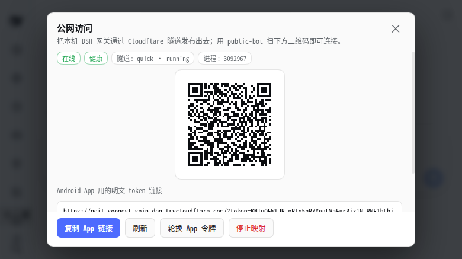

# Bot mode (v0.6.0)

Bot mode adds a dedicated multi-Bot workspace in DeepSeek Harness alongside Harness mode. Each Bot owns an isolated directory (`bot.json`, `SOUL.md`, `MEMORY.md`, `.dsh/skills/team/SKILL.md`), a permanent primary chat Session, per-room hidden Group Sessions, optional pinned model & thinking level, and scoped access to a shared pluggable Team Memory Hub.

## Group Rooms (Hermes Base + Task-Driven Concurrent Actor Bus)

- **Shared Room Log + Per-Member Hidden Sessions + Optional Shared `workDir`**: Room messages carry monotonic `seq` numbers via CAS-capable `appendAtomic`, persist to `state.json`, and append to `$DSH_HOME/botmode/rooms/<roomId>.jsonl`. Each Bot runs group turns in its own hidden room session (`room.memberSessions[botId]`), using either a shared project folder (`room.workDir`) or its isolated Bot folder.
- **Event-Driven Concurrent `BotActor` Bus + Snapshot Watermark Anti-Miss**:
  - Idle `BotActor`s wake up concurrently on Room Log updates without slow-Bot head-of-line blocking; zero-token routing silently advances watermarks when messages exclusively `@mention` other teammates.
  - Watermarks advance strictly to the pre-turn `snapshotSeq` while recording `selfSentSeqs`, guaranteeing concurrent teammate replies and human Soft Steer interjections are never missed.
  - **Multi-Track Ephemeral UI**: Parallel active Bots render live reasoning, tool calls, and streaming text in isolated per-Bot tracks at the bottom of the room, solidifying into the upper Committed Log in deterministic `seq` arrival order upon completion.
- **3 Explicit Business Terminal States (No Hard Round Cutoff by Default)**:
  - `completed`: entered ONLY when an authorized Bot calls `room_finish_task({ summary, deliverables })` (never by plain-text regex).
  - `settled`: all active Bots converge via `(pass)` / `[NO_REPLY]` with zero running turns and zero pending approvals/questions.
  - `waiting_user`: local branch suspension on `approval/request` or `ask_user_question` (without blocking parallel teammates), or explicit `@user`/`@你` escalation; auto-resumes upon human reply/approval.
- **3 Pathological Soft-Pause Probes (`stalled` / `paused_error`)**:
  - `idle_spin`: 5 consecutive pure-text causal rounds with zero tool calls, zero file edits, and zero subtask claims soft-pause the room (`stalled`).
  - `paused_error`: 3 consecutive identical error fingerprints pause ONLY that Bot locally and broadcast a rescue alert to teammates.
  - `token_budget`: soft checkpoint at `tokenLimit` (default 1M tokens, `0` = off) preserving all sessions and watermarks; clicking **Continue** extends the checkpoint seamlessly.
- **Shared Task Board & File Write Soft-Locks**:
  - `claim_subtask({ taskId, title, paths, status })` coordinates subtask ownership and leases file/directory paths; DSH tool pre-execution/guard hooks block concurrent `write` / `edit` / `apply_patch` / `str_replace_editor` mutations on paths locked by a teammate.
- **Soft Steer vs Hard Stop**:
  - Sending a new human message mid-run increments `epoch`, immediately wakes idle Bots, fences stale pre-steer `@mentions`, and lets busy Bots finish their active tool step before automatically absorbing the new instruction via snapshot watermark; `/stop` or clicking **Stop** aborts all in-flight room sessions immediately.

## Team Memory Hub (Pluggable Hermes-style Memory Providers)

- **Single Active Provider, Per-Bot Isolation**: All Bots share one globally active memory provider plugin, scoped per Bot via `(team_id, agent_id = bot.id, user_id, session_id)`.
- **Built-in Providers**:
  - `memory_tencentdb` (default): Connects to the TencentDB Agent Memory v3 HTTP Gateway (`127.0.0.1:8420`) with parallel L1/L2/L3 `prefetch`, non-blocking L0 `syncTurn`, circuit breaker, and automatic local Node 22 SQLite FTS5 fallback when the Gateway is offline.
  - `local_sqlite`: Zero-dependency local SQLite FTS5 (trigram tokenizer for Chinese + English) memory store.
  - `builtin`: Lightweight file-only mode using each Bot's `MEMORY.md`.
- **Download & Swap Plugins**: Install external memory plugins into `$DSH_HOME/botmode/memory-plugins/<id>/` from curated catalog templates (`Mem0`, `Generic HTTP`), `npm:<pkg>`, Git URLs, `.tgz` archives or local plugin directories containing `plugin.json` + ESM `index.js`, and hot-switch at any time from the **Memory Hub** page or `/botmode memory`.

## Remote 入口（v0.7.2）

侧边栏底部新增 **远程 / Remote** 按钮，把本机 DSH 网关通过 Cloudflare 隧道发布到公网，并与桌面 `dsh-remote` 项目联动：

- **一键出链**：点击后调用 `dsh-remote up`（自动发现 `dsh web` 的端口与 launch token、起 `cloudflared`、拿到公网域名），返回完整访问链接 `https://<tunnel>/#k=<访问密钥>`。密钥在 URL fragment 中，Cloudflare 与 CDN 日志都看不到。
- **只保留安卓 App 入口**：弹窗就是一个 App 连接页——二维码（Host 侧零依赖 QR 编码器渲染成 SVG data URL）+ 完整 `?token=` 链接 + 「复制 App 链接 / 刷新 / 轮换 App 令牌 / 停止映射」。Android 客户端不会做 E2E，只有 `?token=` + cookie + `/api/remote.mux` 这条路，所以这里直接给它可用链接；页内明确标注「不是端到端加密，Cloudflare 能看到 token」。relay 关闭 `proxy.appBridge` 时显示启用提示。
- 浏览器的端到端加密链接不再在弹窗里展示，需要时用 CLI：`dsh-remote link`（`#k=` 片段链接）。
- **自动续期**：网关自身的上游 cookie、对外 PSK、隧道 token 由 `dsh-remote` 自动续期；这里额外提供 **轮换密钥**（`dsh-remote rotate`）与 **停止映射**，轮换后在线会话会自动换新密钥，旧链接在宽限期后失效。
- **运行态可见**：弹窗顶部 chips 显示在线/健康、隧道模式与状态、PSK kid、PID；`/botmode/api/remote` 也可被其他面板复用。

Host API：

| 方法 | 路径 / 命令 | 说明 |
|---|---|---|
| GET | `/botmode/api/remote?qr=0` | 运行态 + 链接 + 二维码（`qr=0` 跳过二维码） |
| POST | `command` `{type:'remote.status'}` | 同上（客户端用） |
| POST | `command` `{type:'remote.up'}` | 起网关并等到 `/__dsh/health` 为 200 |
| POST | `command` `{type:'remote.rotate'}` | 轮换 PSK 并等新链接 |
| POST | `command` `{type:'remote.rotateApp'}` | 轮换 App 直连 token 并等新链接 |
| POST | `command` `{type:'remote.down'}` | 停止网关 |
| POST | `command` `{type:'remote.inspect',link}` | 校验链接（CLI / 其他面板可复用，弹窗 UI 已不再使用） |

依赖环境变量：`DSH_REMOTE_BIN`（默认 `~/Desktop/dsh-remote/bin/dsh-remote.mjs`）、`DSH_REMOTE_HOME`（默认 `~/.dsh-remote`）。网关不在本机时不会启用该按钮。
